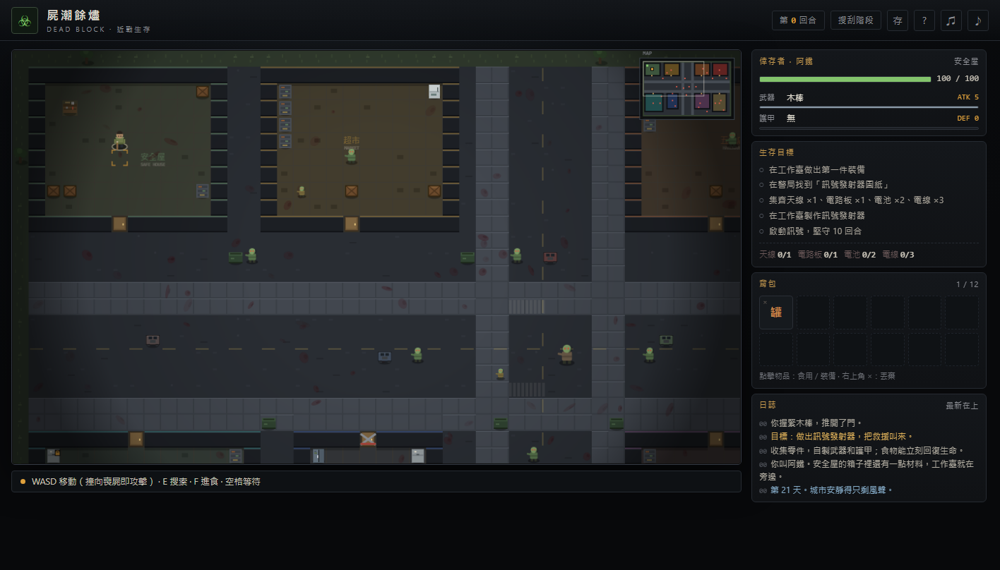

# 屍潮餘燼 · DEAD BLOCK

純 HTML 的回合制喪屍生存遊戲。單檔案、零依賴、零外部資源、**零動畫**。

**線上玩：<https://leeyipkan.github.io/>**



> 也可以直接雙擊 `index.html` 玩（Chrome / Edge / Firefox）。不需要伺服器，不需要連網。

---

## 一句話

你是阿鐵。搜刮街區的零件，在工作臺上自己做武器和護甲，吃食物回血，
最後做出訊號發射器、引來救援，並在安全屋裡守住 10 回合。

## 操作

| 按鍵 | 作用 |
|---|---|
| `W A S D` / 方向鍵 | 移動。**撞向喪屍就是攻擊** |
| `E` | 搜索木箱 / 貨架 / 鐵櫃 / 藥櫃，或使用工作臺 |
| `F` | 吃下背包裡回復量最高的食物 |
| `空格` | 原地等待一回合 |
| 滑鼠 | 點相鄰格移動、點自己腳下互動；點背包物品食用/裝備；右上角 `×` 丟棄 |
| `♫` / `♪` | 開關背景音樂 / 音效 |
| 右上角 `存` | 手動保存進度（平常每次行動也會自動存） |

## 命名與存檔

- **開始時可以取名字**（最多 8 字，預設「阿鐵」）；HUD、日誌、死亡／通關畫面都會用這個名字。
- **自動存檔**：每次行動、製作、裝備、丟棄、啟動訊號後，都會寫入瀏覽器的 `localStorage`。
- **繼續進度**：重新打開頁面時，標題畫面會顯示上次進度摘要（名字、回合、生命、階段）與「繼續進度」按鈕。
- **手動保存**：右上角「存」；成功會寫一行「進度已保存」。
- **死亡或通關會清掉存檔**，避免讀到已經結束的局。
- 存檔只存在這台裝置的瀏覽器裡；換瀏覽器、無痕模式或清除網站資料就會消失。

## 核心循環

1. **搜刮**：每個容器只能搜一次。搜索會發出聲音，把附近的喪屍引過來。
2. **製作**：回到安全屋（左上角）的工作臺。製作不消耗回合，吃東西會消耗回合。
3. **戰鬥**：回合制。你行動一次，喪屍才行動一次。
4. **推進**：撬棍撬開警局的鐵鏈 → 拿天線與圖紙 → 五金店拿電路板 → 湊電池與電線。
5. **終局**：在工作臺做出訊號發射器並啟動 → 安全屋四面牆被撞開六個缺口 → 守住 10 回合。

**安全屋在啟動訊號前是安全區**：屍潮只會聚在門口徘徊，進不來；按下發射器之後，
四面牆會被撞開六個缺口，屍潮從缺口灌進來，這時才真的守不住。

## 地圖（64 × 40 格，約 2.5 倍於舊版）

地圖比視窗大，鏡頭會跟著阿鐵滾動；右上角的小地圖會畫出整張街區、喪屍紅點、
工作臺綠點與當前視野框。

| 地點 | 裡面有什麼 |
|---|---|
| 安全屋（左上） | 工作臺、起始物資 |
| 超市 | 罐頭、麵包、能量棒、玻璃瓶 |
| 五金店 | 廢鐵、木板、膠帶、電線、**電路板 + 消防斧圖紙** |
| 加油站 | 玻璃瓶、膠帶、電池 |
| 醫院 | 繃帶、止痛藥、電池、**上鎖的藥櫃（要撬棍）** |
| 警局 | **天線 + 訊號發射器圖紙**、電池、防暴甲圖紙；大門被鐵鏈鎖死 |
| 公寓 | 食物、布條、木板 |
| 倉庫（右下，新） | 大量廢鐵/木材，**上鎖的鐵櫃**裡還有急救包 |

## 數值表

**武器**（耐久歸零會損壞）

| 武器 | 攻擊 | 耐久 | 材料 |
|---|---|---|---|
| 木棒（初始） | 5 | 25 | — |
| 撬棍 | 7 | 30 | 廢鐵 3 + 木板 1 |
| 釘棒 | 8 | 35 | 木板 2 + 廢鐵 2 + 膠帶 1 |
| 砍刀 | 10 | 45 | 廢鐵 3 + 木板 1 + 膠帶 1 |
| 消防斧 | 15 | 40 | 廢鐵 4 + 木板 2 + 膠帶 2（需圖紙） |

**護甲**

| 護甲 | 減傷 | 耐久 | 材料 |
|---|---|---|---|
| 布甲 | 1 | 20 | 布條 4 + 膠帶 1 |
| 鐵甲 | 3 | 40 | 廢鐵 5 + 布條 2 + 膠帶 2 |
| 防暴甲 | 5 | 60 | 廢鐵 6 + 布條 4 + 膠帶 3（需圖紙） |

**喪屍**

| 喪屍 | 生命 | 傷害 | 行動頻率 | 特點 |
|---|---|---|---|---|
| 行屍 | 14 | 4 | 每 2 回合 | 基礎 |
| 爬屍 | 9 | 3 | 每回合 | 快但脆 |
| 巨屍 | 32 | 9 | 每 3 回合 | 很痛 |
| 噴吐者 | 18 | 5 | 每 2 回合 | 4 格內遠程噴酸，護甲只擋一半 |
| 變異體 | 70 | 13 | 每 2 回合 | 終局出現 |

食物：罐頭 +25、麵包 +15、能量棒 +10、繃帶 +35、止痛藥 +20、急救包 +45（可製作）。
**同一種食物堆疊時，一次只吃一個、只回一次血**，剩餘數量留在背包裡。

## 設計說明

- **回合制**：所有行動在一回合內立即結算，沒有即時計時。
- **零動畫**：畫面全部由 Canvas 靜態向量圖元繪製，沒有補間、幀動畫、粒子或 CSS transition。
- **零資源**：沒有圖片、沒有音訊檔案、沒有字型檔案、沒有 CDN。
- **鏡頭**：世界 1536×960 像素，視窗 1056×600，鏡頭按格瞬移（不做平滑），右上角小地圖導航。
- **背景音樂**：WebAudio 即時合成的低壓環境音（低音持續音 + 稀疏五聲音階），
  屍潮階段自動加快並加入脈衝低頻；右上角 `♫` 開關背景音樂，`♪` 單獨開關音效。
- **單檔案**：`index.html` 約 2500 行，HTML + CSS + JS 全在裡面，可離線、可拷貝。

## 開發驗證

`tools/qa/game-qa.mjs` 用 Node 的 DOM/Canvas 樁載入真實的遊戲腳本，跑 85 條斷言：

```bash
node tools/qa/game-qa.mjs
```

覆蓋：地圖連通性（所有容器/工作臺可接近、警局撬門前後）、通關材料齊備、
製作原子性（材料不足/背包滿不扣材料、圖紙門檻、修補、不能重複造發射器）、
**食物堆疊一次只消耗一個**、搜刮與鎖、戰鬥數值（含噴吐者遠程）、
喪屍尋路（安全屋安全區／破口進入）、**存檔讀檔往返（名字、容器、地形、殭屍）**、
死亡清檔，以及三套裝備的「堅守 10 回合」自動試玩。
